

  <a href="https://kejincai.dev"></a>

  <a href="#work"><b>Work</b></a>
  &nbsp;&nbsp;·&nbsp;&nbsp;
  <a href="https://github.com/kekincai/ai-blog"><b>PAUL.LOG</b></a>
  &nbsp;&nbsp;·&nbsp;&nbsp;
  <a href="https://kejincai.dev"><b>kejincai.dev</b></a>
  &nbsp;&nbsp;·&nbsp;&nbsp;
  <a href="https://stackoverflow.com/users/8745472"><b>Stack Overflow</b></a>
  &nbsp;&nbsp;·&nbsp;&nbsp;
  <a href="mailto:me@kejincai.dev"><b>me@kejincai.dev</b></a>

<picture>
  <source media="(prefers-color-scheme: dark)" srcset="./assets/now.svg">
  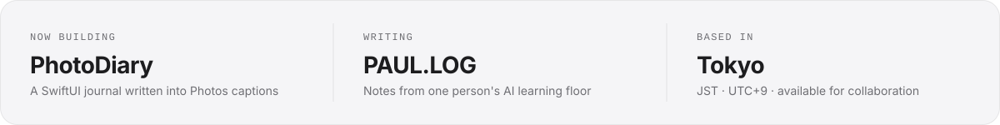
</picture>

<picture>
  <source media="(prefers-color-scheme: dark)" srcset="./assets/h-work.svg">
  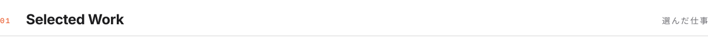
</picture>

  <a href="https://github.com/kekincai/DiskFerry"><picture><source media="(prefers-color-scheme: dark)" srcset="./assets/p-diskferry.svg">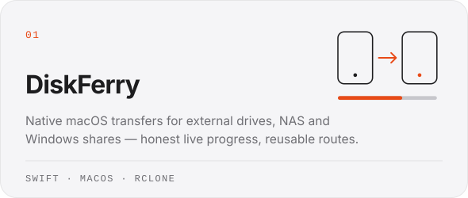</picture></a>
  <a href="https://github.com/kekincai/PhotoDiary"><picture><source media="(prefers-color-scheme: dark)" srcset="./assets/p-photodiary.svg">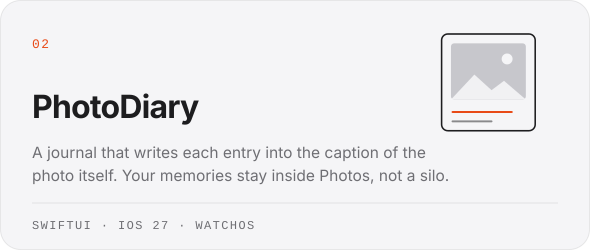</picture></a>

  <a href="https://github.com/kekincai/fde"><picture><source media="(prefers-color-scheme: dark)" srcset="./assets/p-fde.svg">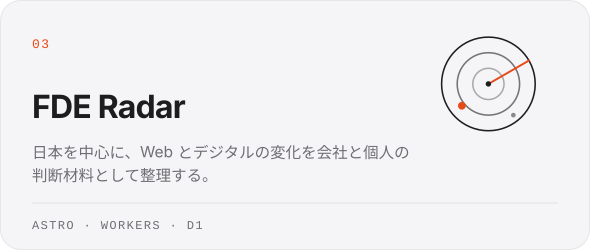</picture></a>
  <a href="https://github.com/kekincai/bookmark-cover-flow"><picture><source media="(prefers-color-scheme: dark)" srcset="./assets/p-bookmark.svg">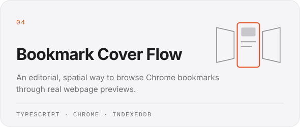</picture></a>

<picture>
  <source media="(prefers-color-scheme: dark)" srcset="./assets/h-tools.svg">
  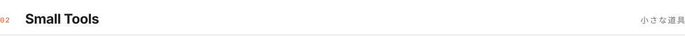
</picture>

  <a href="https://github.com/kekincai/CoBRA"><picture><source media="(prefers-color-scheme: dark)" srcset="./assets/t-cobra.svg">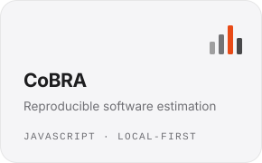</picture></a>
  <a href="https://github.com/kekincai/infinity-newtab-extension"><picture><source media="(prefers-color-scheme: dark)" srcset="./assets/t-newtab.svg">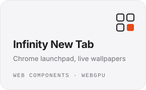</picture></a>
  <a href="https://github.com/kekincai/tidyfs"><picture><source media="(prefers-color-scheme: dark)" srcset="./assets/t-tidyfs.svg">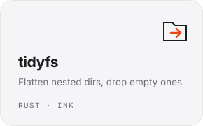</picture></a>
  <a href="https://github.com/kekincai/llm-racket"><picture><source media="(prefers-color-scheme: dark)" srcset="./assets/t-racket.svg">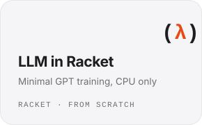</picture></a>

<picture>
  <source media="(prefers-color-scheme: dark)" srcset="./assets/h-stack.svg">
  
</picture>

<picture>
  <source media="(prefers-color-scheme: dark)" srcset="./assets/stack.svg">
  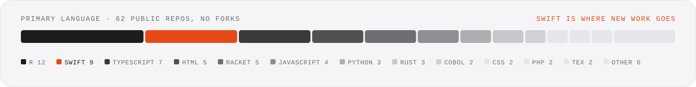
</picture>

<picture>
  <source media="(prefers-color-scheme: dark)" srcset="./assets/footer.svg">
  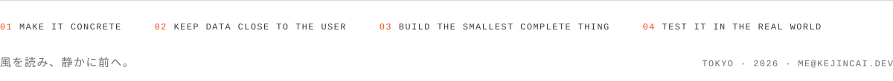
</picture>
